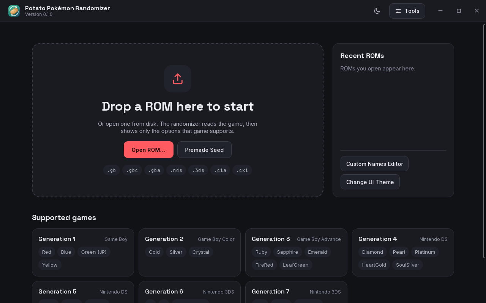
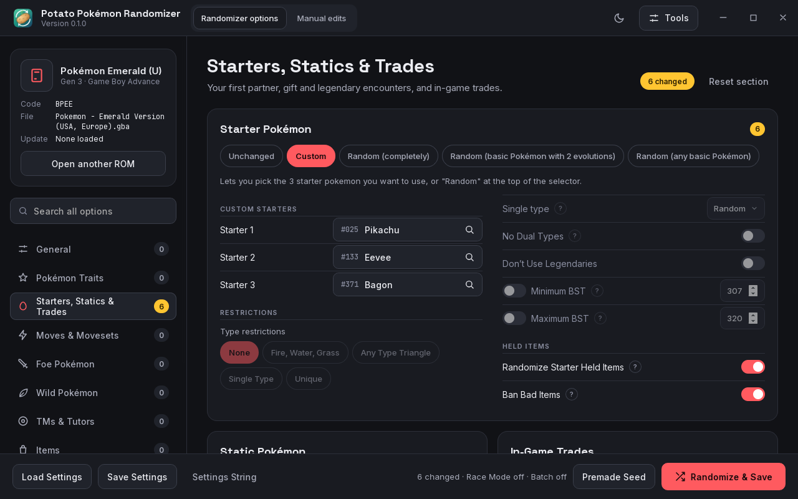
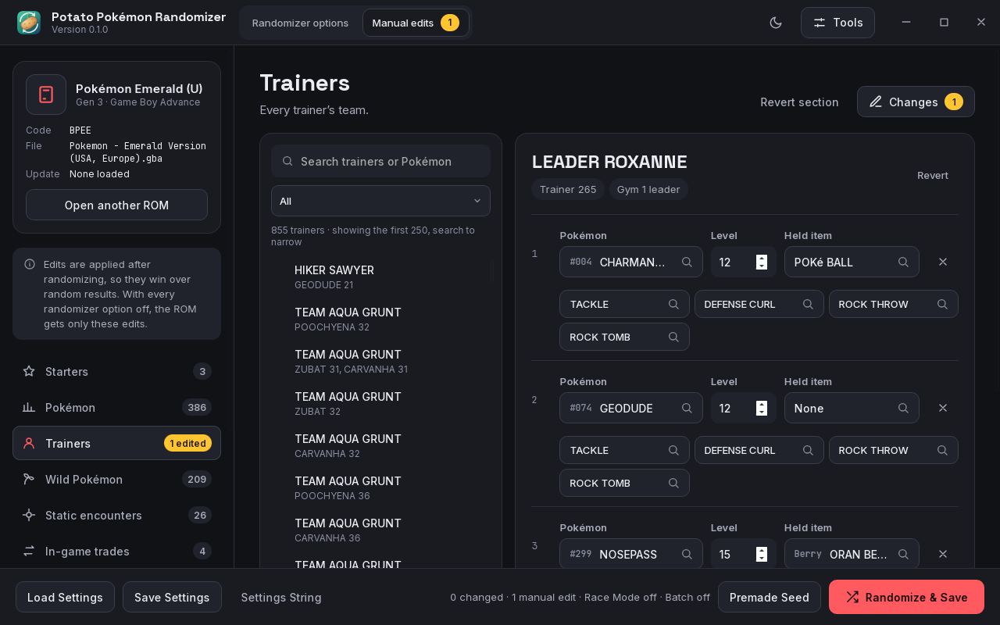
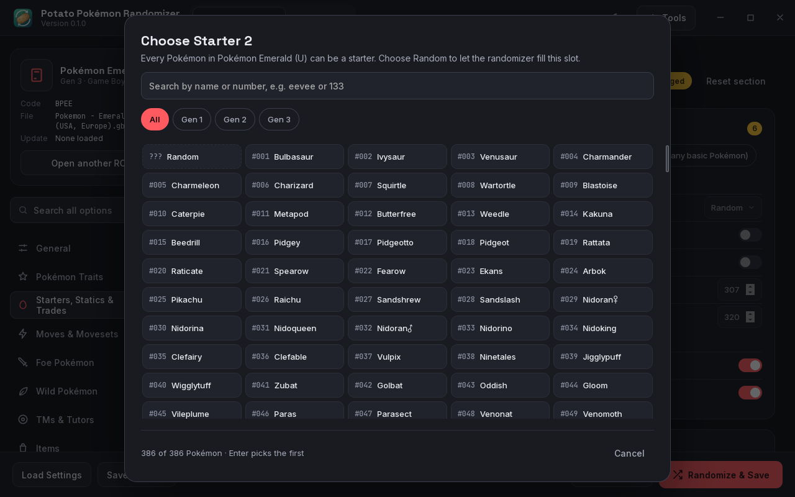
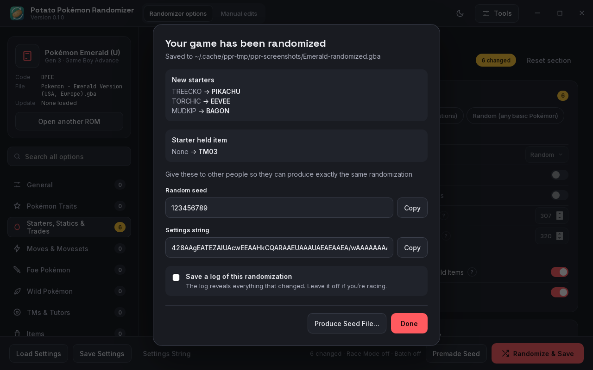
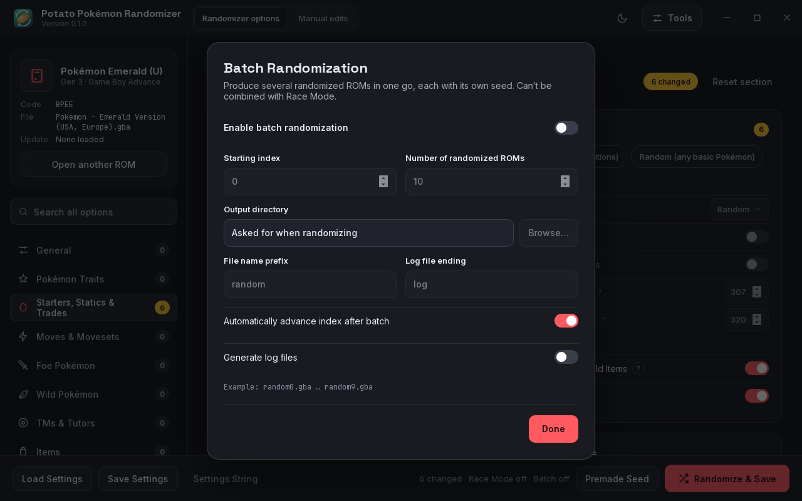

# Potato Pokémon Randomizer

[](https://ko-fi.com/techneut92)

A cross-platform desktop randomizer for Pokémon games, with a Rust backend and a Svelte frontend.
It targets Linux, macOS and Windows.

## Features

- Randomizes starters, wild and static encounters, trainers, movesets, evolutions, types, items and more (Gen 1 to
  7), from a seed that reproduces the same game.
- Settings strings, `.rnqs` settings files and `.rndp` premade seed files of UPR FVX 1.6.2 load as they are.
  Where this randomizer deliberately behaves differently from the original is listed in
  [docs/differences.md](docs/differences.md).
- A manual editor for starters, Pokémon, trainers, wild and static encounters, trades, shops, prices and field items,
  applied after randomizing and checked against what the game can store.
- Batch randomization, logs, and 3DS games saved as a ROM or as a LayeredFS folder.
- A desktop app and a `ppr` command-line tool share the same code.

## Screenshots







| Starter picker | After saving | Batch randomization |
| --- | --- | --- |
|  |  |  |

`pnpm screenshots` retakes them; see [the test strategy](docs/testing.md#10-readme-screenshots).

## Status

| Phase | Scope | State |
| --- | --- | --- |
| 1 | Svelte frontend with every randomization option and rule, driven by a mock backend | Done |
| 2 | Tauri shell and Rust backend (ROM I/O and randomization) | Done: every option for Gen 1 to 7 |
| 3 | Manual editor | Done |

## Stack

- **Frontend:** Svelte 5 (runes), TypeScript, Vite. Fonts are bundled, so the app works offline.
- **Desktop shell (phase 2):** Tauri 2. The Vite config already uses Tauri's fixed dev port and build targets
  (WebView2 on Windows, WebKit on macOS and Linux).
- **Backend (phase 2):** a Cargo workspace of layered crates; see the [architecture decision records](docs/adr/).

## Project layout

```text
crates/
  ppr-formats/               ROM headers, containers, codecs (no Pokémon knowledge)
  ppr-model/                 game data model; types shared with the frontend
  ppr-romio/                 ROM detection and per-generation handlers; embedded ROM entries
  ppr-settings/              randomization settings, shared by the app, the CLI and settings strings
  ppr-random/                seeds, per-step RNG streams, pipeline, progress, cancellation; the randomizers
  ppr-service/               use cases shared by the desktop app and the CLI
  ppr-cli/                   `ppr` command-line tool
src-tauri/                   desktop app (Tauri 2), thin command layer over ppr-service
src/
  App.svelte                 app shell
  lib/
    app.svelte.ts            AppState: one reactive store for screens, options and runs
    backend.ts               Backend interface + MockBackend (Tauri invoke in phase 2)
    options/
      defs.ts                declarative option definitions (sections → groups → options)
      engine.ts              OptionEngine: evaluates enable/disable rules and builds the view model
    data/                    ROM capabilities, national dex, help texts
    components/              UI components; modals/ holds the dialogs and their registry
    generated/               TypeScript types generated from the Rust model (do not edit)
```

The UI never computes rules itself: it renders the view model that `OptionEngine` returns for the
loaded ROM and the current overrides.

## Development

Requires Node.js (current LTS), [pnpm](https://pnpm.io/) and Rust (stable, via rustup; `rust-toolchain.toml`
selects it). The desktop app also needs the
[Tauri prerequisites](https://v2.tauri.app/start/prerequisites/) of your OS.

```sh
pnpm install
pnpm dev                 # frontend only, with the mock backend: http://localhost:1420
pnpm tauri dev           # desktop app
pnpm tauri build         # installers for this OS in target/release/bundle/
tools/bundle.sh          # on Linux: Linux bundles, Flatpak and Windows installer (docs/release.md)
tools/release.sh X.Y.Z   # attach them to the GitHub Release of tag vX.Y.Z

pnpm check               # svelte-check and tsc, fails on warnings
pnpm test                # frontend unit tests (Vitest)
cargo test               # Rust tests; also regenerates src/lib/generated
cargo clippy --workspace --all-targets -- -D warnings
tools/ci.sh              # every CI check, plus cargo deny; web | rust for one half
cargo run -p ppr-cli -- identify <rom>...   # or: games
cargo run -p ppr-cli -- randomize <rom> -o <out> --starters random --seed 42
```

On Fedora Atomic and other image-based systems, build the desktop app in a toolbox container with the Tauri
prerequisites installed; the other crates build on the host.

Tests never use copyrighted ROMs. ROM headers and whole Gen 3 ROMs are built synthetically
(`ppr_romio::testing`); see [the test strategy](docs/testing.md).

## Support

The randomizer is free and stays free. If it saved you some time and you'd like to say thanks, you can
[buy me a coffee on Ko-fi](https://ko-fi.com/techneut92). Donations support the development work only.

Generation 8 and 9 (the Switch games) are technically possible: their game data can be read and the changes
loaded as a LayeredFS mod, as the randomizer already does for the 3DS games. It is a big piece of work, though, so it
depends on whether there is interest. Donations help make it happen. If you donate, leave a note on Ko-fi saying
which game you'd most like to see supported next.

## Credits

Pokémon is a trademark of Nintendo, Game Freak and The Pokémon Company; this project is not affiliated with them.
